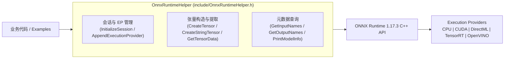

# OnnxRuntimeHelper

> 一个轻量级、类 Python 风格的 ONNX Runtime C++17 推理封装库，消除原生 C++ API 的样板代码，让模型加载、张量构造与推理取值像 Python 一样简洁。

---

## 1. 为什么需要这个项目？

原生 ONNX Runtime C++ API 虽然性能优异，但在日常业务接入中存在较高的心智负担：

- **样板代码繁琐**：每次推理都需要手动管理 `Ort::Env`、`Ort::SessionOptions`、`Ort::MemoryInfo`、`Ort::AllocatorWithDefaultOptions` 以及 C 风格输入/输出名称指针数组。
- **字符串张量处理复杂**：构造和读取 `ONNX_TENSOR_ELEMENT_DATA_TYPE_STRING` 张量需要手动处理偏移量与内存缓冲区。
- **跨平台路径与硬件后端差异**：Windows 下的宽字符（`wchar_t*`）模型路径转换、CUDA / DirectML / TensorRT / OpenVINO 等执行提供程序（EP）的回退逻辑需要重复编写。

`OnnxRuntimeHelper` 将上述底层细节封装为单一 RAII 类，提供**零额外第三方依赖**、开箱即用的 C++17 推理接口。

---

## 2. 架构与核心特性



- **类 Python 极简接口**：构造即加载模型，一行代码完成张量创建、推理执行与结果提取。
- **多数据类型支持**：通过模板方法原生支持 `float`、`double`、`int32_t`、`int64_t` 等数值类型，并提供专用 `CreateStringTensor` / `GetStringTensorData` 处理字符串张量。
- **多硬件后端与自动回退**：支持按优先级指定 `CPU`、`CUDA`、`DirectML`（Windows）、`TensorRT`、`OpenVINO`，硬件初始化失败时自动回退到 CPU。
- **开箱即用的元数据自省**：内置 `GetInputNames`、`GetOutputNames`、`GetInputShape`、`GetOutputShape` 与 `PrintModelInfo`，方便快速排查模型输入输出签名。
- **跨平台路径兼容**：在 Windows 下自动将 UTF-8 模型路径转换为 `std::wstring`，避免中文路径加载失败。

---

## 3. 目录结构

```text
onnxruntimehelper/
├── include/
│   └── OnnxRuntimeHelper.h      # 核心封装类声明与模板实现
├── src/
│   └── OnnxRuntimeHelper.cpp    # 会话管理、EP 配置、字符串张量与元数据实现
├── examples/
│   ├── main.cpp                 # 基础用法、GPU 加速、多数据类型等综合示例
│   └── check_nlp_models.cpp     # NLP 文本分类模型推理示例
├── tests/
│   ├── test_basic.cpp           # 基础编译、链接与接口冒烟测试
│   └── unit_tests.cpp           # 基于真实 ONNX 模型（MNIST / ResNet18 等）的单元测试
├── docs/
│   ├── 使用文档.md              # 详细 API 参考与进阶示例
│   ├── 获取ONNX_Runtime.md      # ONNX Runtime 1.17.3 下载与环境配置指南
│   └── 单元测试说明.md          # 测试模型下载与测试用例说明
├── CMakeLists.txt               # CMake 构建配置（C++17）
└── README.md
```

---

## 4. 快速上手 (Quick Start)

### 前置条件

- **CMake**：3.17 及以上
- **编译器**：支持 C++17 的编译器（GCC 7+ / Clang 5+ / MSVC 2019+）
- **ONNX Runtime**：`v1.17.3` 预编译库

> 请先按照 [docs/获取ONNX_Runtime.md](./docs/获取ONNX_Runtime.md) 下载并解压 `onnxruntime-v1.17.3` 到项目根目录（或通过 CMake 参数 `-DONNXRUNTIME_ROOT_DIR=/your/path` 指定路径）。

### 编译与运行

```bash
# 1. 配置构建
cmake -B build -S .

# 2. 编译（Linux / macOS）
cmake --build build -j

# 2. 编译（Windows MSVC）
cmake --build build --config Release

# 3. 运行基础冒烟测试
./build/test_basic                 # Linux
.\build\Release\test_basic.exe     # Windows
```

### 最小代码用例

```cpp
#include <iostream>
#include <vector>
#include "OnnxRuntimeHelper.h"

int main() {
    // 1. 加载模型（默认使用 CPU；也可传入 {ExecutionProvider::CUDA, ExecutionProvider::CPU}）
    OnnxRuntimeHelper helper("model.onnx");
    helper.PrintModelInfo();

    // 2. 构造输入张量（注意：input_data 的生命周期必须覆盖 Run() 调用期间）
    std::vector<float> input_data(1 * 3 * 224 * 224, 0.5f);
    std::vector<int64_t> input_shape = {1, 3, 224, 224};

    std::vector<Ort::Value> inputs;
    inputs.push_back(helper.CreateTensor(input_data, input_shape));

    // 3. 运行推理
    auto outputs = helper.Run(
        helper.GetInputNames(),
        inputs,
        helper.GetOutputNames()
    );

    // 4. 提取输出数据
    auto output_data = helper.GetTensorData<float>(outputs[0]);
    std::cout << "输出元素数量: " << output_data.size() << std::endl;
    return 0;
}
```

---

## 5. 核心 API 速查

| 类别 | 方法签名 | 说明 |
| :--- | :--- | :--- |
| **构造与初始化** | `OnnxRuntimeHelper(model_path, providers)` | 加载模型并按顺序初始化执行提供程序（默认 `{ExecutionProvider::CPU}`） |
| **张量创建** | `CreateTensor<T>(data, shape)` | 创建数值类型张量（`float`、`int32_t`、`int64_t`、`double` 等），校验元素数量与形状匹配 |
| **字符串张量** | `CreateStringTensor(strings, shape)` | 创建 `ONNX_TENSOR_ELEMENT_DATA_TYPE_STRING` 张量 |
| **执行推理** | `Run(input_names, input_tensors, output_names)` | 执行同步推理并返回输出张量列表 |
| **数据提取** | `GetTensorData<T>(tensor)` | 将数值张量拷贝提取为 `std::vector<T>` |
| **字符串提取** | `GetStringTensorData(tensor)` | 将字符串张量提取为 `std::vector<std::string>` |
| **元数据查询** | `GetInputNames()` / `GetOutputNames()` | 获取模型输入/输出节点名称列表 |
| **形状查询** | `GetInputShape(index)` / `GetOutputShape(index)` / `GetTensorShape(tensor)` | 获取模型或运行时张量维度（动态维度返回 `-1`） |
| **调试辅助** | `PrintModelInfo()` | 打印模型所有输入输出的名称与形状 |

---

## 6. 设计权衡与已知限制 (Design Trade-offs)

在集成到生产环境前，请注意以下实现边界：

1. **输入张量的非持有视图（Zero-Copy 语义）**
   `CreateTensor` 直接引用传入 `std::vector<T>` 的底层内存（内部使用 `const_cast` 适配 ORT C++ API），**不会拷贝输入数据**。请务必确保输入 `std::vector` 在 `Run()` 返回前保持有效且未发生重分配。
2. **线程数与图优化级别配置时机**
   当前构造函数会立即创建 `Ort::Session`（默认 `intra_op_num_threads = 1`，`ORT_ENABLE_ALL`）。因此在当前版本中，构造后调用 `SetThreadCount()` 或 `SetGraphOptimizationLevel()` 会打印警告并被忽略；若需自定义线程数，建议在 `OnnxRuntimeHelper::InitializeSession` 中调整或扩展构造参数。
3. **执行提供程序（EP）平台与依赖约束**
   - `ExecutionProvider::DirectML` 仅在 Windows（`_WIN32`）下生效；
   - `CUDA` / `TensorRT` / `OpenVINO` 依赖对应版本的 ONNX Runtime Provider 动态库，若初始化失败会捕获异常并自动回退至 CPU。
4. **线程安全性**
   `OnnxRuntimeHelper` 禁用拷贝构造与拷贝赋值；单实例内的 `Ort::Session::Run` 遵循 ONNX Runtime 本身的线程安全模型，但建议每个工作线程持有独立输入/输出向量。

---

## 7. 进阶文档

- **完整 API 与多场景示例**：[docs/使用文档.md](./docs/使用文档.md)
- **ONNX Runtime 依赖下载与 GPU 配置**：[docs/获取ONNX_Runtime.md](./docs/获取ONNX_Runtime.md)
- **单元测试模型准备与用例说明**：[docs/单元测试说明.md](./docs/单元测试说明.md)
